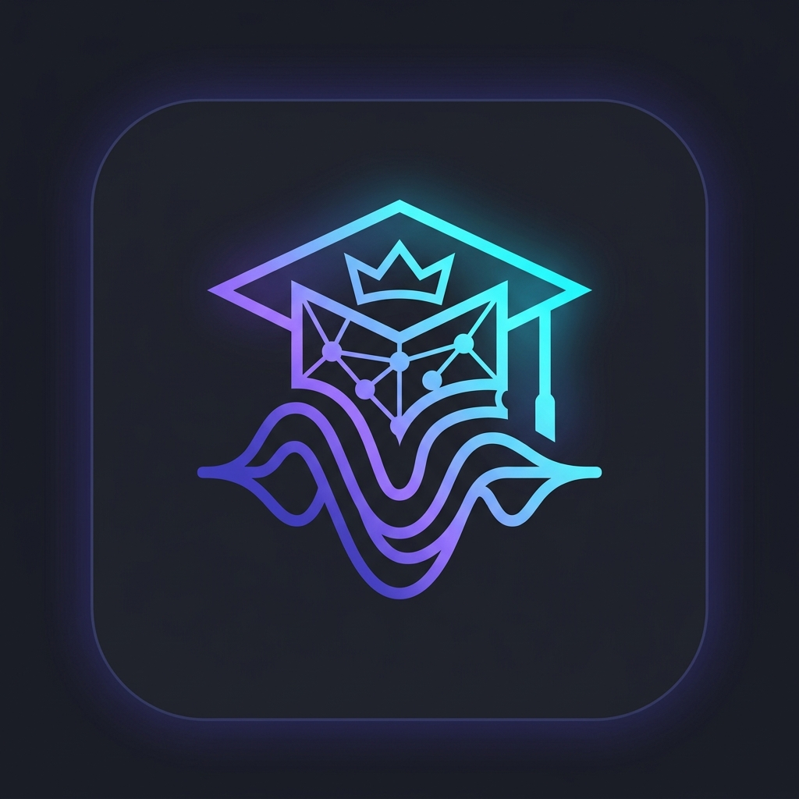

# My Tutor 🎓 — Offline AI Study Companion & Personal Professor

<p align="center">
  
</p>

<p align="center">
  <strong>A 100% Offline-First, Privacy-Focused AI Personal Professor for B.Tech & Engineering Undergraduates.</strong><br>
  Built with Flutter & Dart, powered by localized on-device GGUF neural models, Google ML Kit OCR, and local voice synthesis.
</p>

<p align="center">
  
  
  
  
  
</p>

---

## 🌟 Overview

**My Tutor** is an interactive, on-device AI voice tutor and engineering study companion tailored for undergraduate engineering students (B.Tech CSE/IT/ECE/EE/ME). 

Engineering students often grapple with complex mathematical derivations, circuit theories, quantum mechanics, and programming memory models late at night without access to faculty or high-speed internet. **My Tutor** addresses this challenge with a **100% local-first, privacy-by-design architecture** that executes quantized Large Language Models directly on the device's CPU, offering instantaneous step-by-step guidance in natural, conversational **Hinglish**, **English**, and **Pure Hindi**.

---

## 🛠️ Software Stack & Technologies

| Layer | Technology | Details |
| :--- | :--- | :--- |
| **Framework** | **Flutter** (v3.24+ / v3.27+) | High-performance reactive UI framework rendering at 90/120Hz |
| **Language** | **Dart** (v3.5+) | Strongly typed, null-safe asynchronous programming language |
| **State Management** | **Provider** (`package:provider`) | Clean separation of business logic across reactive stores |
| **On-Device LLM Runtime** | **llama_cpp_dart** (`llama.cpp`) | Native ARM64/ARMv8 C++ inference via Dart FFI bindings |
| **On-Device OCR** | **Google ML Kit** | Latin-script OCR extracting text from photos locally on-device |
| **Document Parsing** | **Syncfusion Flutter PDF** | Client-side parsing and text extraction for student PDF notes |
| **Voice Recognition** | **speech_to_text** | Real-time speech transcription with audio waveform animation |
| **Speech Synthesis** | **flutter_tts** | On-device Text-to-Speech (TTS) audio narration |
| **Storage Engine** | **Custom File-Based JSON** | Room-partitioned storage via `path_provider` & `shared_preferences` |
| **Typography** | **Google Fonts** | *Poppins* (headings) & *Inter* (body, formulas, code) |
| **3D Visualizer** | **WebGL / HTML5** | Embedded 3D Rubik's Cube solver utilizing the Kociemba algorithm |
| **Target Platform** | **Android** | Minimum SDK 26 (Android 8.0 Oreo), Target SDK 34 (Android 14) |

---

## 🧠 AI Models & Inference Engine

My Tutor implements a flexible multi-tier reasoning pipeline:

### 1. Supported On-Device GGUF Models (4-bit Quantization)
* **Google Gemma 4 (2B Parameter):**
  * *Identifier:* `gemma-4-2b-it-Q4_K_M.gguf` (`google_gemma-4-E2B-it-Q4_K_M.gguf`)
  * *License:* **Apache License 2.0**
  * *Footprint:* ~1.3 GB download, ~1.4 GB runtime RAM
  * *Role:* Primary engineering tutor model; specializes in conceptual rigor, step-by-step calculus derivations, and physics explanations.
* **Alibaba Cloud Qwen 2.5 (1.5B Parameter):**
  * *Identifier:* `Qwen2.5-1.5B-Instruct-Q4_K_M.gguf`
  * *License:* **Apache License 2.0**
  * *Footprint:* ~1.1 GB download, ~1.1 GB runtime RAM
  * *Role:* Coding tutor; specializes in C memory management, pointers, and Data Structures & Algorithms.
* **Meta Llama 3.2 (1B Parameter):**
  * *Identifier:* `Llama-3.2-1B-Instruct-Q4_K_M.gguf`
  * *License:* **Llama 3.2 Community License Agreement**
  * *Footprint:* ~0.7 GB download, ~750 MB runtime RAM
  * *Role:* Ultra-fast lightweight model for budget Android devices and quick definitions.

### 2. Built-in Offline Fallback Engine (`Prof. AI Offline Engine`)
* Built directly into the app with **0 MB extra download**.
* Provides immediate, reliable answers for core syllabus topics (Semiconductors, Lasers, Polymers, Batteries, Eigenvalues, Partial Differentiation, Linked Lists, C Pointers).

### 3. Optional Online Search / AI Mode (Pollinations AI)
* Strictly **opt-in** via Settings for students wishing to query live web information.
* Communicates over HTTPS to Pollinations AI (`https://text.pollinations.ai/`) with realtime token streaming.

For detailed model benchmarks and technical parameters, refer to [android/models.md](android/models.md).

---

## 🚀 Key Features

### 🗣️ Trilingual Teaching Engine
* **Hinglish (Default):** Natural blend of Hindi grammar and English engineering terminology (*"Is matrix ki characteristic equation solve karo"*).
* **English:** Formal academic English matching university exam standards.
* **Pure Devanagari Hindi (हिन्दी):** Complete Hindi technical instruction with feminine professor honorifics (*"मैं समझाती हूँ"*).
* **Instant Bubble Translation:** Tap the **Translate (अनुवाद)** button on any message to switch between languages on the fly.

### 📷 Multimodal Doubt Input
* **Voice Input (STT):** Dictate doubts hands-free with an animated soundwave level indicator.
* **Photo OCR Doubt Scanner:** Snap photos of textbook problems or handwritten notes. Extracted text is processed instantly via on-device Google ML Kit.
* **PDF & Document Attachments:** Attach PDF lecture notes or TXT files. The content is indexed into room memory for contextual Q&A and viva prep.

### 🔊 Audio Voice Tutoring (Sunao TTS)
* **Female Professor Persona ("Prof. AI"):** Clear, encouraging voice narration.
* **Auto-Speak:** Automatically reads out answers upon completion.
* **Configurable Pace:** Speed rate slider (0.25x to 1.0x) in Settings.
* **Per-Message Audio:** Tap "Sunao (TTS)" on any bubble to play or pause.

### 📐 Mathematical Typography Formatter
* Converts raw LaTeX backslashes into human-readable Unicode notation:
  * Fractions: `\frac{a}{b}` $\rightarrow$ `a/b`
  * Exponents: `x^2` $\rightarrow$ `x²`
  * Subscripts: `u_x` $\rightarrow$ `uₓ`
  * Roots: `\sqrt{x}` $\rightarrow$ `√(x)`
  * Calculus & Greek: `\partial` $\rightarrow$ `∂`, `\int` $\rightarrow$ `∫`, `\theta` $\rightarrow$ `θ`, `\pi` $\rightarrow$ `π`, `\infty` $\rightarrow$ `∞`
* Formatted formulas are easy to read and pronounce naturally via TTS.

### 🎲 3D Interactive Rubik's Cube Solver
* Algorithmic spatial tutor with an interactive 3D WebGL cube.
* Supports manual face-by-face color input, randomized scrambling, and step-by-step animated solutions using the Kociemba Two-Phase algorithm.

### 💻 Multi-Language Code Runner
* In-app code workbench supporting **C**, **C++**, **Python**, and **Java** via the Wandbox API.
* Write, edit, and compile code directly to verify tutorial exercises.

### 🔒 Privacy-First Data Architecture
* **Partitioned Storage:** Chat messages are saved in discrete JSON files (`tutor_data/chats/{chapterId}.json`) to eliminate UI lag.
* **Storage Dashboard:** View disk usage broken down by chat messages, uploaded documents, downloaded AI models, and backups.
* **Data Control:** One-tap "Clear Room Chat" and "Clear All Data" tools.
* Zero analytics, zero ad tracking, and no compulsory user account creation.

For comprehensive details on tools and features, see [android/tools.md](android/tools.md) and [android/features.md](android/features.md).

---

## 📁 Repository Structure

```
My-Tutor/
├── android/                        # Android native project configuration
│   ├── app/                        # Main Android application module
│   │   ├── build.gradle.kts        # Android build configuration & dependencies
│   │   └── src/main/AndroidManifest.xml
│   ├── models.md                   # Detailed documentation of on-device LLMs
│   ├── tools.md                    # Catalog of open-source tools & libraries
│   └── features.md                 # Full breakdown of app features & capabilities
├── assets/                         # Bundled static assets
│   ├── cube_www/                   # Embedded WebGL 3D Rubik's Cube solver
│   └── models/                     # Model configuration manifests
├── lib/                            # Dart source codebase
│   ├── core/                       # Core utilities, theme, and constants
│   │   ├── constants/              # System prompts, model URLs, and keys
│   │   └── theme/                  # AMOLED dark theme and color palette
│   ├── data/                       # Data layer & service providers
│   │   ├── models/                 # Subject, chapter, chat, and document models
│   │   └── services/               # LLM, Storage, FileStorage, TTS, Voice, OCR, PDF
│   ├── legal/                      # Terms of Use & Privacy Policy markdown texts
│   ├── presentation/               # UI presentation layer
│   │   ├── screens/                # Home, Chat Room, Subject Detail, Settings, etc.
│   │   └── widgets/                # ChatBubble, VoiceControlBar, SubjectCard, etc.
│   └── providers/                  # Application state providers (Provider pattern)
├── pubspec.yaml                    # Flutter project dependencies and metadata
├── LICENSE                         # Project MIT License
└── README.md                       # Main project documentation
```

---

## ⚙️ Prerequisites & Setup

Ensure the following tools are installed on your workstation:

1. **Flutter SDK:** Version `3.24.0` or newer (`flutter doctor` should report no issues).
2. **Dart SDK:** Included with Flutter (`>= 3.5.0`).
3. **Android Studio / Android SDK:**
   * Android SDK Platform 34 (UpsideDownCake) or newer
   * Android SDK Build-Tools (34.0.0+)
   * Android NDK & CMake (for compiling native C++ `llama.cpp` bindings if needed)
4. **Physical Device or Android Emulator:**
   * Android 8.0+ (API level 26 minimum; recommended Android 12+ / API 31+)
   * 4 GB+ RAM recommended for running on-device GGUF models.

---

## 🔨 Build & Run Commands

### 1. Clone Repository & Install Dependencies
```bash
# Clone the repository
git clone https://github.com/TricksXTech/My-Tutor.git

# Navigate into the project directory
cd My-Tutor

# Fetch Flutter packages
flutter pub get
```

### 2. Verify Code Quality
```bash
# Run static Dart analysis
flutter analyze
```

### 3. Run on Connected Device (Debug Mode)
```bash
# Check connected devices
flutter devices

# Launch app in debug mode on your connected phone/emulator
flutter run
```

### 4. Build Production Release APK
```bash
# Compile optimized release APK
flutter build apk --release

# The compiled APK will be located at:
# build/app/outputs/flutter-apk/app-release.apk
```

### 5. Build Android App Bundle (for Google Play Distribution)
```bash
# Compile optimized release AAB
flutter build appbundle --release

# The compiled bundle will be located at:
# build/app/outputs/bundle/release/app-release.aab
```

### 6. Install Release APK to Connected Device
```bash
# Install directly via adb
adb install -r build/app/outputs/flutter-apk/app-release.apk
```

---

## 📄 License & Attribution

* **Application Code:** Distributed under the [MIT License](LICENSE).
* **AI Model Licenses:**
  * Google Gemma 4: [Apache License 2.0](https://www.apache.org/licenses/LICENSE-2.0)
  * Qwen 2.5: [Apache License 2.0](https://www.apache.org/licenses/LICENSE-2.0)
  * Meta Llama 3.2: [Llama 3.2 Community License Agreement](https://www.llama.com/llama3/license/)
* **Third-Party Libraries:** All third-party Flutter packages retain their original open-source licenses (BSD, MIT, Apache 2.0). License notices can be viewed within the app under **Settings > About > View Open Source Licenses**.

---

<p align="center">
  Crafted with ❤️ by <strong>Usman Raza</strong> (TricksXTech) for engineering students everywhere.
</p>
